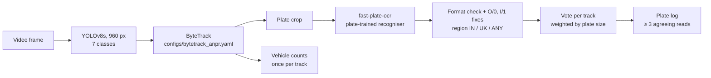

# 🚗 Traffic Monitoring & Number Plate Recognition (ANPR), audited and rebuilt

Detect vehicles and number plates, track them through video, read the plates and log each one once.
YOLOv8 · ByteTrack · fast-plate-ocr · OpenCV · Streamlit · pytest · GitHub Actions

This started as a course project that reported **98.5 % mAP**. I audited it, found the number came from
leaked data and that plate reading had never been measured, and rebuilt the evaluation and the pipeline.
Everything below is measured on held-out data by a script in this repo.

## Results at a glance

| | Original project | After the audit and rebuild |
|---|---|---|
| Detector mAP50 | 0.985, on a validation split that leaked into training | **0.743** on held-out scenes (YOLOv8s) |
| Training data | 1,782 images | 903 unique images (**49 % were duplicate copies**) |
| Readable test plates read exactly (single frame, hand-labelled) | 0 / 37 (EasyOCR) | 6 / 37 (plate-trained OCR) |
| Logged plates that are correct | 0 % | **67 %** (OCR on labelled crops) · **71 %** (full pipeline, detector boxes) |
| Character error rate on test plates | 0.91 | **0.23** |
| 4K traffic clip, 300 frames | 38 log entries, 2 valid plates | **9 plates logged, 9 correct, no duplicates** |
| Vehicle counting in video | once per frame (a car seen in 100 frames = 100 cars) | once per tracked vehicle |

Details: [`docs/audit.md`](docs/audit.md) (all findings, in order), [`docs/results/`](docs/results/).

## What the audit found

1. **Leakage.** A perceptual-hash check found that **82.6 % of validation and 86.0 % of test images** had a
   near-duplicate in another split. The merge had included the same frames two or three times (once as `.jpg`,
   once as `.png`; two downloads of one dataset), plus consecutive frames from fixed traffic cameras.
   `tools/check_leakage.py`, `tools/inspect_leakage.py`
2. **Plate reading had never been measured.** The tracker's own plate log contained 2 valid plates out of 38
   entries. Two-line plates were cut in half because the code kept only one OCR fragment.
3. **The pipeline didn't match the model.** The video scripts ran the detector at 640 px although it was trained
   at 960 px, and the dashboard counted every vehicle again in every frame.
4. **The data isn't one country.** The video footage is British, some images are Mexican, and a "blurred plate"
   class had been merged into "plate". Only **19 %** of test plates are readable by a person at all.

## How it works now



One implementation, [`src/anpr/pipeline.py`](src/anpr/pipeline.py), is used by the dashboard, the
command-line tool and the end-to-end evaluation, so what is measured is what runs.

- **Format check, not guessing.** A reading is accepted only if it is a valid plate for the chosen region. Common
  OCR confusions are fixed only where the plate format requires it (at most 2 changes), and a truncated read
  is never "repaired" into a different valid-looking plate.
- **Voting.** A car is visible in many frames. Each track votes on its plate; a plate is logged once, when at
  least 3 reads agree. Readings one character away from a stronger one are merged into it.

## Results in detail

### Detection: leak-free split v2, retrained on Kaggle (T4), same hyper-parameters as the original

Split: duplicates removed, every scene kept in one split, seeded: train 629 / val 151 / **test 123** images.
`best.pt` chosen on val; test used once.

| model | params | train time | test mAP50 | test mAP50-95 |
|---|---|---|---|---|
| **YOLOv8s** (deployed) | 11 M | 48 min | **0.743** | 0.519 |
| YOLOv8l (same size as the original) | 44 M | 159 min | 0.707 | 0.508 |

Per class (YOLOv8s, test mAP50): Car 0.92 · Bike 0.91 · Number plate 0.85 · Auto 0.84 · Truck 0.71 · Bus 0.54 ·
Person 0.43. Bus and Person have few training examples (197 and 56 boxes).
With 629 training images the small model matches the large one at a quarter of the size.
[`docs/results/detector_v2.md`](docs/results/detector_v2.md)

### Plate reading: 250 hand-labelled test plates

Only 48 of 250 test plates are readable by a person; the scores use the 37 readable Indian plates
(13 different vehicles, many seen in consecutive frames).

| OCR | exact | correct when logged | character error rate |
|---|---|---|---|
| original pipeline (EasyOCR) | 0 / 37 | 0 % | 0.91 |
| best EasyOCR variant | 2 / 37 | 33 % | 0.87 |
| **fast-plate-ocr + format check** | **6 / 37** | **67 %** | 0.23 (raw) |

End to end on single test frames (detector finds the plate, then OCR): the detector found **100 %** of the
readable plates; 71 % of logged plates were correct. The bottleneck is reading, not finding.
[`docs/results/ocr_eval.md`](docs/results/ocr_eval.md), [`docs/results/end2end.md`](docs/results/end2end.md)

### Video: 4K British traffic, first 300 frames

**9 plates logged, all 9 correct**, each from one track, no duplicates; 28 cars and 3 trucks counted;
**2.3 fps on a laptop GPU (GeForce MX250, 4 GB)**. This clip is one of the sources of the detector's training
frames, so treat it as a demo, not a held-out score.
[`docs/results/video_demo.md`](docs/results/video_demo.md) also lists what each fix changed on this clip,
including a tracking bug: Ultralytics fixes the `persist` setting on the first `track()` call, so starting
with `persist=False` had re-created the tracker on every frame.

## Limitations

- Plates under about 20 px tall are mostly unreadable, by the model and by people.
- 13 distinct test vehicles is a small OCR test set; differences of one or two plates are within noise.
  No confidence intervals yet.
- The plate recogniser is used as downloaded (not fine-tuned). One Delhi plate is misread the same way in
  every frame, which voting can't fix; fine-tuning on Indian plates is the next step.
- Format rules exist for Indian and current UK plates; other countries use `--region ANY` (no correction).
- The detector training data is small (903 images) and mixes countries.

## Quick start

```bash
git clone https://github.com/shubhampandey97/number-plate-vehicle-detection.git
cd number-plate-vehicle-detection
conda env create -f environment.yml && conda activate anpr_env
# PyTorch first: CUDA 12.6 build shown; use the cpu index URL without an NVIDIA GPU
pip install torch==2.11.0 torchvision==0.26.0 --index-url https://download.pytorch.org/whl/cu126
pip install -r requirements.txt -r requirements-dev.txt
pytest -q tests
```

Weights are not in git: put the trained detector in `models/yolov8s_v2.pt` (see [`models/README.md`](models/README.md)).
The plate recogniser downloads itself on first use.

```bash
streamlit run app/streamlit_app.py                                          # dashboard: image / video / webcam
python tools/run_video.py traffic.mp4 --region UK --save-video              # plates.csv, counts.json, annotated.mp4
python tools/run_video.py photo.jpg                                         # single image
```

## Reproduce the evaluation

```bash
python tools/check_leakage.py --root data/final_merged_datasets    # leakage in the original split
python tools/make_group_split.py                                   # build split v2 -> data/final_v2
python tools/check_leakage.py --root data/final_v2                 # expect 0 cross-split pairs
# train: notebooks/kaggle_train_v2.ipynb on Kaggle (or scripts/train.py on a local GPU)
python tools/eval_detector_test.py --weights models/yolov8s_v2.pt  # held-out detector metrics
python tools/make_ocr_labelset.py && streamlit run tools/label_ocr_app.py   # cut + hand-label plate crops
python tools/eval_ocr.py --gpu --fastplate cct-s-v2-global-model   # OCR comparison
python tools/eval_end2end.py                                       # detector + OCR on single frames
```

## Project structure

```text
src/anpr/        pipeline (detect → track → OCR → check → vote), plate rules, voting, OCR readers
tools/           leakage checks, split builder, labelling app, evaluations, run_video CLI
app/             Streamlit dashboard
configs/         tracker settings for queued traffic
scripts/         training script, dataset preparation, EDA
notebooks/       Kaggle training notebook
tests/           64 pytest tests, incl. a fake-detector pipeline test (run in GitHub Actions)
docs/            audit, leakage reports, results
results/         training curves and metrics per model
models/, data/   weights and datasets (not in git)
```

## Background

The original version (YOLOv8l, EasyOCR, ByteTrack, Streamlit) was built for a GUVI data science course and
written up in a 48-page report. Its headline numbers (precision 96.2 %, recall 97.3 %, mAP50 98.5 %) were
validation scores on the leaked split and should not be read as performance. The full history is in the git
log and in [`docs/audit.md`](docs/audit.md).

## Author

**Shubham Pandey**: data science & machine learning ·
[LinkedIn](https://www.linkedin.com/in/shubham-pandey-4092781a6/) · [GitHub](https://github.com/shubhampandey97)
